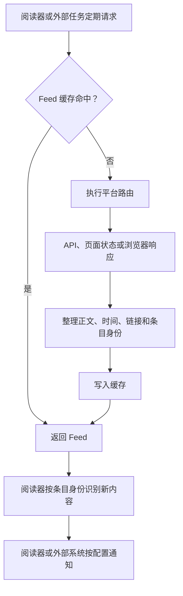
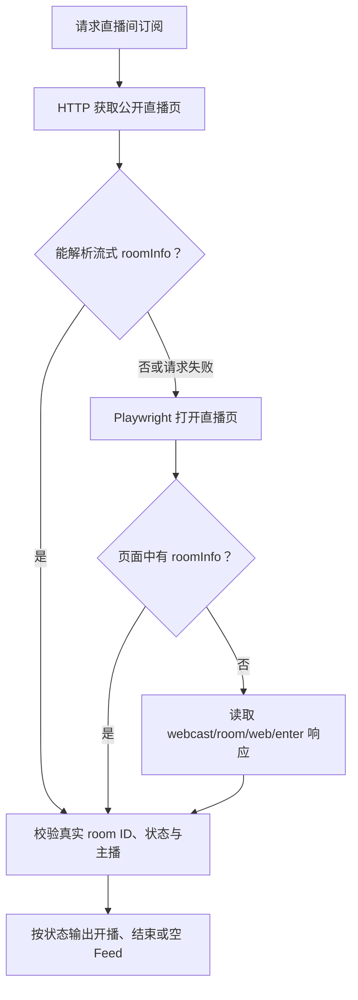
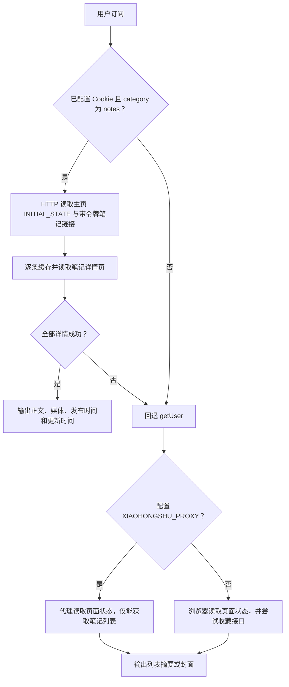

# 六个平台的数据采集与订阅监控链路

RSSHub 通过站点 API、页面内嵌状态或浏览器网络响应获取近期内容，再转换为统一的 Feed。微博、Twitter/X、抖音、小红书、快手和 Telegram 都沿用这套机制；实际更新检查由 RSS 阅读器或外部任务定期请求触发。直播和 Spaces 路由能够输出当前状态，但不会自行发送通知、录制媒体或保存完整事件历史。

本文面向自托管实例的维护者，说明各平台的凭据、入口、采集流程、缓存、条目身份和故障定位。源码基线为 `38638e6947212e02b465d2bacb9c60caf36fcb92`，核查日期为 **2026-11-17**；整理时维护分支为 `custom-main`，HEAD 为文档初始化提交 `830a040`。本次只做源码核查，没有配置真实账号、访问平台接口或运行浏览器验收。文中的路由存在性与实现机制已经核对，线上可用性仍需使用自己的实例验证。

安装和部署见[使用指南](usage.md)，改动代码与升级流程见[二次开发指南](development.md)，分支状态见[维护记录](maintenance.md)。本文中的路径示例需加上自己的 RSSHub 实例地址；尖括号形式的参数名是需要替换的源站标识。

按平台阅读：[微博](#2-微博列表-apicookie-与详情补全) · [Twitter/X](#3-twitterx两类-api-后端与统一-feed) · [抖音](#4-抖音浏览器作品接口与直播状态) · [小红书](#5-小红书页面状态全文补全与降级) · [快手](#6-快手浏览器监听用户作品响应) · [Telegram](#7-telegram公开网页与用户会话-api)。接入操作见[验收与排障](#8-用同一套步骤接入与排障)。

## 1. 先理解“监控”的工作范围

### 请求、缓存与阅读器的分工



源码依据：[Feed 缓存中间件](../../lib/middleware/cache.ts)、[内容缓存](../../lib/utils/cache/index.ts)、[通用参数处理](../../lib/middleware/parameter.ts)。路由返回结构化数据，核心处理参数并生成 RSS、Atom 或 JSON Feed。

| 机制 | 当前默认或行为 | 运维影响 |
| --- | --- | --- |
| Feed 缓存 | `CACHE_EXPIRE=300`，单位秒 | 过期后的下一次请求才重新运行路由 |
| 内容缓存 | `CACHE_CONTENT_EXPIRE=3600`，单位秒 | 详情可能继续复用旧值；各路由可覆盖 TTL |
| `cache.tryGet()` | 默认命中时续期；第四个参数 `false` 表示不续期 | 续期仅延长旧值寿命，不会后台更新正文 |
| 并发请求协调 | 内存与 Redis 后端有原子占用机制 | 内存仅在本进程内协调；不能据此推断所有平台有全局限速 |
| 条目去重 | 路由提供 `guid`，缺省时通常使用条目链接 | 同一条目改标题、正文或状态，阅读器未必重新通知 |
| 历史保留 | 这些路由主要返回首屏或有限条近期内容 | Redis 缓存不等于文章数据库或完整事件日志 |

默认值来自 [config.ts](../../lib/config.ts)。多层缓存会共同影响可见延迟；将阅读器轮询间隔设得很短，并不保证每次都访问源站。读取过于频繁还可能不断续期详情缓存，使文章编辑迟迟不被重新采集。

六个平台的这些路由没有提供统一的关注/取关关系差分、粉丝变动历史、删帖记录、互动数时间序列、全量历史回补和消息投递重试系统。要实现这些能力，应在 Feed 消费端增加持久化快照、差分与通知任务，并记录每次成功采集时间。条目从近期窗口消失，也不能直接判定为删除。

### 采集方式总览

| 平台 | 主要采集机制 | 凭据与浏览器 | 可以订阅的主要对象 |
| --- | --- | --- | --- |
| 微博 | 移动端列表 API，必要时补详情；另有官方 OAuth 时间线 | `WEIBO_COOKIES` 可配置；游客 Cookie 获取使用浏览器 | 博主、关注时间线、分组、本人收藏、关键词、话题 |
| Twitter/X | 网页 GraphQL，或开发者 API v2；部分独立路由另有要求 | 网页用 `TWITTER_AUTH_TOKEN`；通用采集无需 Playwright | 用户推文、媒体、列表、搜索、首页、Spaces 状态 |
| 抖音 | 浏览器访问页面并读取作品接口；直播先读 HTML | 需要浏览器回退能力；本人喜欢/收藏用 `DOUYIN_COOKIE` | 博主作品、标签、可见喜欢列表、本人收藏、直播间 |
| 小红书 | HTML 内嵌状态，或浏览器页面状态与收藏接口 | `XIAOHONGSHU_COOKIE` 可开启全文路径；存在浏览器回退 | 用户笔记、可见收藏、专辑 |
| 快手 | 浏览器访问主页并监听作品接口响应 | 需要浏览器；该路由没有专用 Cookie 配置入口 | 用户作品 |
| Telegram | 公开频道网页，或用户 Session 的 MTProto API | 公开网页无需登录；MTProto 用 `TELEGRAM_SESSION`；无需浏览器 | 频道消息、Stories；另有官方博客与贴纸包 |

表中的配置只决定当前代码如何发起请求。账号可见范围、网络、平台权限、验证码和接口变化仍决定请求能否成功。接入账号私有数据时，应按[使用指南中的访问控制说明](usage.md#4-配置缓存浏览器和访问控制)限制整个实例的访问。

## 2. 微博：列表 API、Cookie 与详情补全

### 博主订阅链路

入口为 [user.ts](../../lib/routes/weibo/user.ts)，共享逻辑在 [utils.ts](../../lib/routes/weibo/utils.ts)。

```text
/weibo/user/:uid/:routeParams?
  → tryWithCookies() 获取配置 Cookie 或游客 Cookie
  → m.weibo.cn/api/container/getIndex?type=uid&value=uid
  → 读取 userInfo 与微博 tab 的 containerid
  → 使用 containerid 请求 cards
  → 保留 mblog，按参数过滤转发
  → 按 bid 缓存并补充单条微博详情
  → formatExtended() 整理正文、图文、作者、时间和 guid
  → 清理早于普通内容窗口的陈旧置顶条目
  → 返回 Feed
```

这里的 `uid` 是微博数字用户 ID。列表取首屏，不提供翻页回补。详情优先访问 `m.weibo.cn/statuses/show?id=bid`；文本或图片不完整时，再请求 `weibo.com/ajax/statuses/show`，携带长文本选项。

`WEIBO_COOKIES` 配置存在时优先使用。没有配置时，共享工具通过 Playwright 打开移动站获取游客 Cookie，并缓存结果，通过合并并发请求与冷却机制减少重复获取。游客鉴权失效时可尝试刷新再重试；手动配置的登录 Cookie 失效则要求维护者更新，没有自动登录或自动续签账号的完整流程。仅登录可见的博主不能据此保证游客可读。

默认展示视频、包含转发，不展开头条文章和评论。`displayArticle`、`displayComments` 打开时会增加文章或热门评论请求，不代表采集全部评论。

```text
/weibo/user/1195230310
/weibo/user/1195230310/showRetweeted=false&displayArticle=true
```

第二条中的选项位于路径最后一段。通用的 `?limit=5&format=json` 则由 RSSHub 核心处理，两者不能混淆。

### 关注、分组、收藏与 OAuth 时间线

| 入口 | 实际含义 | 边界与源码 |
| --- | --- | --- |
| `/weibo/friends/:routeParams?` | 登录账号关注用户的微博内容流 | 是发帖时间线；不是新增关注事件。[friends.ts](../../lib/routes/weibo/friends.ts) |
| `/weibo/group/:gid/:gname?/:routeParams?` | 登录账号某个分组的内容流 | 依赖账号 Cookie 与分组权限。[group.ts](../../lib/routes/weibo/group.ts) |
| `/weibo/user_bookmarks/:uid/:routeParams?` | 配置 Cookie 对应账号的收藏 | 会检查登录 UID 与路径 UID 一致；不能读任意人的私有收藏。[user-bookmarks.ts](../../lib/routes/weibo/user-bookmarks.ts) |
| `/weibo/timeline/:uid/:feature?/:routeParams?` | OAuth 授权账号的首页时间线 | 调用官方 `statuses/home_timeline.json`，不是任意博主主页。[timeline.ts](../../lib/routes/weibo/timeline.ts) |
| `/weibo/keyword/:keyword/:routeParams?` | 关键词检索结果 | 内容由搜索接口决定，不保证覆盖全部匹配微博。[keyword.ts](../../lib/routes/weibo/keyword.ts) |
| `/weibo/super_index/:id/:type?/:routeParams?` | 超话内容 | 依赖超话页面与接口结构。[super-index.ts](../../lib/routes/weibo/super-index.ts) |
| `/weibo/search/hot/:fulltext?` | 热搜 | [search/hot.tsx](../../lib/routes/weibo/search/hot.tsx) |
| `/weibo/fresh/:id` | 新鲜事主题 | [fresh.ts](../../lib/routes/weibo/fresh.ts) |
| `/weibo/oasis/user/:userid` | 绿洲用户内容 | [oasis/user.ts](../../lib/routes/weibo/oasis/user.ts) |

OAuth 路径使用 `WEIBO_APP_KEY`、`WEIBO_APP_SECRET` 和 `WEIBO_REDIRECT_URL`。授权回调换取用户 Token，按源站 `expires_in` 缓存，再以该 Token 请求首页时间线，代码请求数量为 100。启用访问控制时，授权流程还使用短时、一次性的 state；实现见 [weibo-oauth.ts](../../lib/utils/weibo-oauth.ts)。具体授权与接口权限仍需用自己的微博应用验证。

### 缓存与监控边界

博主信息和 cards 的缓存键包含 Cookie 摘要，按路由 TTL 保存且不因读取续期。详情以 `weibo:user:complete:<bid>` 缓存，使用内容缓存默认行为，因此不能承诺实时反映编辑。常规条目 GUID 由 UID 与微博 bid 组成，链接切换为移动版时仍保留稳定 GUID；OAuth 时间线路由保留其历史 GUID 格式。

持续订阅博主可以发现新进入结果窗口的微博；收藏与关注时间线也是内容快照。无法由这些 Feed 直接得知关注关系变化、完整评论新增、取消收藏时刻或删帖时刻。鉴权失败先检查 Cookie 对应账号能否看到原始页面，再检查详情补全是否受限。

## 3. Twitter/X：两类 API 后端与统一 Feed

### 后端如何选择

[api/index.ts](../../lib/routes/twitter/api/index.ts) 在模块加载时按以下顺序选择后端：

1. 配置 `TWITTER_THIRD_PARTY_API` 或 `TWITTER_AUTH_TOKEN`：使用网页 API 实现。
2. 否则，同时配置 `TWITTER_CONSUMER_KEY` 与 `TWITTER_CONSUMER_SECRET`：使用开发者 API 实现。
3. 都未满足：初始化时报配置错误。

这不是网页失败后自动切换开发者 API 的容灾链路。第三方地址也只代理实现列出的操作，其余操作仍可能需要 X 登录 Token。用户名和密码自动登录、旧移动 API 的入口当前被注释；目录中保留相关文件，不表示运行中启用了它们。

### 网页 API 链路

主要源码：[user.ts](../../lib/routes/twitter/user.ts)、[web-api/api.ts](../../lib/routes/twitter/api/web-api/api.ts)、[web-api/utils.ts](../../lib/routes/twitter/api/web-api/utils.ts)。

```text
/twitter/user/:id/:routeParams?
  → api.init() 初始化 GraphQL 操作映射
  → UserByScreenName 或 UserByRestId 解析用户
  → UserTweets，或 UserTweetsAndReplies
  → 提取时间线 instructions / entries / modules / 置顶项
  → gatherLegacyFromData() 统一推文与用户结构
  → 按参数过滤转发、媒体等内容
  → ProcessFeed() 生成图文、引用、视频、作者、时间与 guid
```

`id` 可以是用户名，也可以是带 `+` 前缀的数字用户 ID。默认不包含回复、包含转发；网页 `UserTweets` 还会过滤回复和自回复串的续篇。需要回复时使用 `includeReplies=true`。

```text
/twitter/user/_RSSHub
/twitter/user/+44196397
/twitter/user/_RSSHub/includeRts=false&includeReplies=false
/twitter/user/_RSSHub/includeReplies=true
```

`TWITTER_AUTH_TOKEN` 是网页 Cookie 中的 `auth_token`，支持以逗号分隔多个值。请求工具将其装入 CookieJar，访问 X 获取配套 Cookie，再通过 `undici.fetch` 和 CookieAgent 发送 GraphQL 请求，附带 CSRF 等会话头。部分用户名解析请求允许无登录请求，不代表整个推文订阅支持匿名采集。

Token 按进程中的索引轮转，结合缓存锁避开暂时占用的 Token；接近限额或遇到 429 时延长冷却，401/403 时从当前进程的可用池移除。代码没有启用自动重新登录，维护者仍需更新失效 Token。这个锁并非严格的跨进程全局限流器；多账号的权限和首页内容也可能不同，不能把轮转池理解为某个订阅固定绑定一个账号。

GraphQL 查询 ID 由 [gql-id-resolver.ts](../../lib/routes/twitter/api/web-api/gql-id-resolver.ts) 从社区维护的 `TwitterInternalAPIDocument` 拉取并缓存，失败时使用内置 ID。`UserTweetsAndReplies` 和 `SearchTimeline` 还使用 [client-transaction-id.ts](../../lib/routes/twitter/api/web-api/client-transaction-id.ts) 生成请求标识；特定 404 会刷新相关信息后重试一次。这些机制依赖 X 网页协议和外部资料，不能消除协议变化风险。

名为 `paginationTweets()` 的函数目前只发起一次时间线请求，没有自动追逐游标。用户列表通常请求 20 条；媒体和网页搜索路径固定请求 20 条。Feed 的 `limit` 控制最终输出，不提供完整回补保证。

### 开发者 API 链路

[developer-api/api.ts](../../lib/routes/twitter/api/developer-api/api.ts) 使用开发者凭据初始化 SDK；需要用户授权的操作还取决于 `TWITTER_ACCESS_TOKEN`、`TWITTER_ACCESS_SECRET` 与应用权限。这里描述代码，不对当前平台套餐、价格或账号可调用权限作保证。

用户时间线流程是：

```text
解析用户 → 读取上次有限快照 → 找出最大推文 ID
  → 请求 users/:id/tweets，存在旧快照时附 since_id
  → 将新增结果与快照合并、按 ID 去重并排序
  → 截断到 count，缓存快照 → 映射为统一推文结构
```

这是一个减少重复拉取的增量快照，默认 `count=20`。快照存于内容缓存，失效后从近期结果重新开始；没有持久化游标、完整历史数据库或分页补齐。仅用 `since_id` 拉新也不会重新核查旧快照中已删除或已编辑的推文。

### 路由范围与 Spaces

| 入口 | 用途 | 实现边界 |
| --- | --- | --- |
| `/twitter/user/:id/:routeParams?` | 用户推文 | 可控制回复、转发；是有限内容窗口 |
| `/twitter/media/:id/:routeParams?` | 媒体推文 | 网页后端使用 `UserMedia`；开发者后端从近期推文中过滤媒体 |
| `/twitter/likes/:id/:routeParams?` | 用户喜欢内容 | 网页后端存在查询映射问题，见下一节；开发者后端仍受权限约束 |
| `/twitter/list/:id/:routeParams?` | 列表内容 | 列表是发帖集合，不是成员增删事件 |
| `/twitter/keyword/:keyword/:routeParams?` | 关键词搜索 | 网页使用 `SearchTimeline` 的 `Latest`，开发者后端使用 recent search |
| `/twitter/home/:routeParams?` | 登录账号首页 | 内容随选中的登录会话而变 |
| `/twitter/home_latest/:routeParams?` | 最新关注时间线 | 开发者后端调用存在 UID 问题，见下一节 |
| `/twitter/tweet/:id/status/:status/:original?` | 指定推文与可用上下文 | 不是无限追溯的完整对话归档 |
| `/twitter/trends/:woeid?` | 地区趋势 | 独立调用开发者 v1 API，不能只靠网页 Token |
| `/twitter/spaces/:username` | 用户正在主持或发言的 Space | 独立使用网页会话，需要 `TWITTER_AUTH_TOKEN` |

Spaces 实现位于 [spaces.ts](../../lib/routes/twitter/spaces.ts)：解析用户 → `/fleets/v1/avatar_content` 获取当前 Space → `AudioSpaceById` 获取详情 → 检查状态为 `Running` 且用户属于管理员或发言者。仅作为听众不会输出为正在发言。

活动条目 GUID 为“用户 ID + Space ID”，`pubDate` 使用源站实际开始时间。无活动时输出固定的 inactive 条目，不填造当前时间。相同 Space 内的角色变化或再次进入同一个 Space 不一定形成新条目；代码没有加入房间、收听音频或录音。

统一渲染位于 [twitter/utils.ts](../../lib/routes/twitter/utils.ts)：支持返回数据中已有的长文、引用、图像、视频，回复上下文最多利用已有父链的五层，不额外无限追踪。条目链接使用 `x.com`，GUID 则保留对应 `twitter.com` 链接，以兼容既有订阅。用户资料缓存 24 小时，因此昵称、简介等变化也不会立即可见。点赞数展示只是当前抓取的数值，没有增长趋势数据库。

### 当前基线已识别的兼容问题

以下为静态调用链发现，**尚未修复或做线上验证**：

| 问题 | 代码证据 | 对使用的影响 |
| --- | --- | --- |
| 网页 Likes 操作未进入映射 | `web-api/api.ts` 调用 `paginationTweets('Likes', ...)`，但 [gql-id-resolver.ts](../../lib/routes/twitter/api/web-api/gql-id-resolver.ts) 的操作集合没有 `Likes` | 无法生成正确操作 URL，不能将喜欢路由视为已可用 |
| 开发者首页缺少 UID | [home.ts](../../lib/routes/twitter/home.ts) 与 [home-latest.ts](../../lib/routes/twitter/home-latest.ts) 传入空字符串，开发者实现会拒绝空 UID | 切换到开发者后端后，这两条首页路由不能按当前调用方式工作 |
| `forceWebApi` 没有实际切换效果 | [utils.ts](../../lib/routes/twitter/utils.ts) 解析出 `force_web_api`，调用端没有消费该结果 | 不应使用这个参数承诺为单条订阅切换后端 |

遇到 Twitter 错误时，先确认实际选择的后端，再分别检查 Token、应用权限、429 冷却、GraphQL ID 和时间线结构。不要把静态兼容问题归因于用户 Cookie，也不要因增加一个参数就认为后端已经切换。

## 4. 抖音：浏览器作品接口与直播状态

### 博主与标签内容

[user.ts](../../lib/routes/douyin/user.ts) 的入口为 `/douyin/user/:uid/:routeParams?`。参数使用网页用户主页中的 `sec_user_id`，不是展示用抖音号。代码会检查预期前缀，建议直接复制主页 URL 的用户段。

1. 新建 Playwright 页面，允许文档、脚本和 XHR，拦截其余资源。
2. 在导航之前注册响应等待，然后访问 `www.douyin.com/user/<uid>`。
3. 捕获 URL 包含 `/web/aweme/post` 的首个匹配响应，读取 JSON 中的 `aweme_list`。
4. 从作品作者字段取得昵称与头像，按视频 ID 生成链接，按 `create_time` 生成发布时间。
5. 映射文字、封面、码率资源和标签，返回首屏作品；在 `finally` 中关闭浏览器上下文。

源码依据：[user.ts](../../lib/routes/douyin/user.ts)、[getApiResponse()](../../lib/routes/douyin/utils.ts)。签名和会话环境由运行中的源站网页产生；该路由没有在 Node 中自行实现签名算法，也没有把 `DOUYIN_COOKIE` 注入这个博主采集分支。它依赖匿名网页仍能返回作品，遇到 WAF、非 JSON、非成功响应或空列表时会失败。

默认以封面展示；`embed=true` 可嵌入视频，`iframe`、`relay` 影响媒体呈现或反向代理链接。视频资源 URL 的有效期、跨站播放和网络可达性仍由源站/CDN 决定，Feed 成功不代表以后始终可播放。

```text
/douyin/user/MS4wLjABAAAARcAHmmF9mAG3JEixq_CdP72APhBlGlLVbN-1eBcPqao
/douyin/hashtag/1592824105719812
```

[hashtag.ts](../../lib/routes/douyin/hashtag.ts) 同样使用浏览器，等待 `/v1/web/challenge/aweme` 响应，并读取 `#RENDER_DATA` 里的话题信息。两者将源数据按 `CACHE_EXPIRE` 缓存，读取不续期，没有滚动或翻页补齐。

### 喜欢与本人收藏

| 入口 | 所需身份 | 读取范围 |
| --- | --- | --- |
| `/douyin/likes/self` | 必须配置 `DOUYIN_COOKIE` | 登录账号喜欢的视频首屏 |
| `/douyin/likes/:uid` | 目标列表必须对当前访问身份可见；可配置 Cookie | 指定用户可见的喜欢列表首屏 |
| `/douyin/collection` | 必须配置 `DOUYIN_COOKIE` | 登录账号收藏的视频首屏；不包括音乐、合集、收藏夹和短剧 |

共同实现在 [saved-posts.ts](../../lib/routes/douyin/saved-posts.ts)：页面加载前设置 `.douyin.com` Cookie → 打开个人页 → 等待并点击“喜欢”或“收藏”标签；收藏还会点击“视频” → 捕获对应的 `/aweme/v1/web/aweme/favorite/` 或 `/aweme/v1/web/aweme/listcollection/` 响应 → 校验状态、非空列表与昵称 → 输出视频条目。

响应检查包含主 frame，指定目标用户时还检查 `sec_user_id`，缓存键包含类型、用户和 Cookie 摘要。不同 Cookie 的采集缓存分开，不意味着公共订阅地址已具备访问权限隔离，仍要保护实例入口。

这些条目使用视频原始发布时间和视频链接身份，不提供点赞/收藏发生时间。同一视频取消后再喜欢或再收藏，通常仍是原来的条目身份，不能据此记录每次操作事件。

### 直播间状态链路

[live.ts](../../lib/routes/douyin/live.ts) 的 `/douyin/live/:rid/:showTime?` 接收 `live.douyin.com` 页面中的数字直播间标识。



公开页面解析只读取 `self.__pace_f.push(...)` 中的结构化 JSON，不执行抓取到的脚本。浏览器回退允许页面运行，并读取流式 HTML 或直播间 enter 接口。房间数据按路由 TTL 缓存。

当前状态映射：`status=2` 输出“开播”；`status=4` 输出“当前直播已结束”；其他状态可能为空，路由显式允许空内容。GUID 使用源站返回的本场真实 `room.id_str`，不是请求地址中的固定直播间标识。

`showTime=true` 在标题里显示 RSSHub **首次观察到该 room ID 的时间**，使用 UTC+8 展示。记录缓存 30 天且读取不续期，内存重启、缓存清除或到期会重置；它不等于实际开播时间，也不会写入 `pubDate`。

```text
/douyin/live/685317364746
/douyin/live/685317364746/true
```

同一场直播的开播和结束条目 GUID 相同，所以结束更可能是既有条目更新，是否通知由阅读器决定。轮询期间完全错过的短直播不会自动补齐；需要每次开关播事件时，应由外部任务保存状态并进行比较。

## 5. 小红书：页面状态、全文补全与降级

### 用户笔记的两条读取路径

入口 [user.ts](../../lib/routes/xiaohongshu/user.ts)：`/xiaohongshu/user/:user_id/:category/:routeParams?`。`user_id` 为用户主页中的 24 字符标识；`category` 是必需的路径段，使用 `notes` 或 `collect`。



源码依据：[util.ts](../../lib/routes/xiaohongshu/util.ts)。配置 Cookie 且订阅笔记时，`getUserWithCookie()` 请求主页 HTML，提取 `window.__INITIAL_STATE__`，同时从笔记链接收集 `xsec_token` 等查询参数并保留到详情请求。详情再从页面状态中提取正文、图片/视频、`time`、`lastUpdateTime`。

`renderNotesFulltext()` 并发请求当前笔记列表的详情，通过 `cache.tryGet()` 缓存。`displayLivePhoto=1` 可将有可用视频源的 Live Photo 渲染为视频；默认作为图片。任一详情或主页请求异常都会进入外层回退，整份 Feed 可能从全文退化为封面列表；降级后的条目不保证带日期，因此“能读到 Feed”不能单独作为全文验收标准。

无 Cookie 或发生上述回退时，`getUser()` 默认使用 Playwright：检测验证码元素，解析内嵌状态；若收藏未显示锁定，再点击收藏标签并等待 `/api/sns/web/v2/note/collect/page`。该浏览器分支没有显式注入 `XIAOHONGSHU_COOKIE`，不要把回退理解为带着原登录身份自动重试。

```text
/xiaohongshu/user/593032945e87e77791e03696/notes
/xiaohongshu/user/593032945e87e77791e03696/notes/displayLivePhoto=1
/xiaohongshu/user/593032945e87e77791e03696/collect
```

### 代理、收藏、专辑与 Cookie 检查

`XIAOHONGSHU_PROXY` 是本路由专用的 HTML 获取服务地址，代码使用 `代理地址?url=编码后的目标地址` 获取内容；不同于全局网络代理配置。这个分支不显式将 Cookie 转发给代理，并要求返回可解析的源站 HTML。代理开启后的 `getUser()` 路径无法采集收藏数据，不能通过配置它解决收藏访问问题。

`collect` 读取的是目标用户对当前访问身份可见的收藏，没有读取任意私有收藏的能力。未捕获到收藏结果、列表为空或不可见时可能统一报“收藏内容不可见”，因此该错误也需要结合页面、登录状态和浏览器接口响应诊断。

[board.ts](../../lib/routes/xiaohongshu/board.ts) 提供 `/xiaohongshu/board/:board_id`：读取页面 `window.__INITIAL_SSR_STATE__.Main`，从 `albumInfo` 和 `notesDetail` 生成专辑封面列表。配置代理时改为从返回 HTML 提取同一状态，没有复用用户笔记的全文流程。

[check-cookie.ts](../../lib/routes/xiaohongshu/check-cookie.ts) 提供 `/api/xiaohongshu/check-cookie` API，调用用户 `me` 接口，成功时返回 `{ "code": 0 }`，无有效登录信息时返回负值；网络或接口异常仍可能抛错。`/api` 前缀由[注册逻辑](../../lib/registry-helpers.ts)添加。它用于检查会话，不是 RSS Feed，也不代表所有笔记、收藏和详情请求都能通过风控。

### 缓存与变化识别

普通用户/专辑源数据按路由 TTL 缓存，读取不续期。全文详情缓存键包括笔记 URL 和 Live Photo 显示选项，默认使用内容 TTL 并在命中时续期；带令牌 URL 变化可能产生新的详情缓存键。全文 GUID 仍使用不带访问令牌的笔记身份链接。

全文路径会输出源站发布时间和更新时间；普通封面列表没有填写相应日期。已有笔记即使正文更新，GUID 仍相同，阅读器是否显示更新取决于自身行为；这些路由不保存正文历史、取消收藏事件或点赞数曲线。

## 6. 快手：浏览器监听用户作品响应

当前快手目录只有 [profile.ts](../../lib/routes/kuaishou/profile.ts) 这条作品路由：

```text
/kuaishou/profile/3xk46q9cdnvgife
```

它接收快手主页 URL 中的 `principalId`，执行以下流程：

1. 新建 Playwright 页面，关闭默认定时销毁，由路由负责释放；仅放行文档、脚本、XHR 和 fetch。
2. 打开 `www.kuaishou.com` 建立网页访问环境。
3. 注册 `/live_api/profile/public` 成功响应的等待，再访问 `live.kuaishou.com/profile/<principalId>`。
4. 读取 `response.data.list`；同时尝试从 `/live_api/baseuser/userinfo/byid` 的响应取得用户名。
5. 每个作品使用作者名、封面和 `playUrl` 生成视频内容，使用作品 `item.id` 作为 GUID。
6. 在 `finally` 里关闭页面上下文，并收尾已登记的用户信息请求。

用户资料请求只用于优化 Feed 标题；缺失时使用 ID 构造标题，不应让可选资料覆盖作品主响应。作品响应最多等待 30 秒，期间可能遭遇登录限制、验证码或页面协议变化。

这条路由没有专用快手 Cookie 环境变量和显式注入逻辑，没有翻页、详情补全或自有源数据缓存，主要由核心 Feed 缓存减少重复浏览器访问。当前映射没有填写作品标题、作品网页链接与发布时间，Feed 本身也没有填写主页链接；能输出视频和稳定 GUID，不代表已有完整文章元数据。

虽然访问域名和接口含有 `live`，这里读取的是用户作品列表，不能据此认为实现了快手开播监控。当前目录没有独立的快手直播、关注关系、点赞或收藏路由。视频采用远程播放地址，媒体可用性需要单独验收。

## 7. Telegram：公开网页与用户会话 API

### 频道入口如何选后端

[channel.ts](../../lib/routes/telegram/channel.ts) 提供 `/telegram/channel/:username/:routeParams?`。公开频道示例：

```text
/telegram/channel/awesomeRSSHub
/telegram/channel/awesomeRSSHub/includeFwd=0&includeReply=1
/telegram/channel/awesomeRSSHub/includeTelegraph=true
```

代码按以下条件分流，**最后一段路径参数会改变采集方式**：

| 条件 | 选择 |
| --- | --- |
| 未配置 `TELEGRAM_SESSION` | 公开网页 |
| 路径存在非空 `routeParams`，包括搜索词或显示选项 | 公开网页，即使配置了 Session |
| Cloudflare Workers 环境 | 公开网页 |
| 配置 Session、无额外路径参数且非 Workers | 优先 MTProto |
| MTProto 抛 `FloodWaitError` 或超过 `REQUEST_TIMEOUT` | 回退公开网页 |
| MTProto 其他错误 | 直接失败，不统一回退 |

因此，给原本使用 MTProto 的订阅添加 `includeFwd=0`，会同时切换到公开预览；私有或预览不可用的频道可能因此失败。普通 `?format=json&limit=5` 属于核心查询参数，不是上述路径段。

### 公开网页链路

```text
username + 可选 searchQuery
  → GET https://t.me/s/<username>[?q=...]
  → 内容按路由 TTL 缓存，读取不续期
  → Cheerio 解析 .tgme_widget_message_wrap
  → 识别文本、媒体、转发、回复、投票、服务消息等
  → 按显示与包含选项生成正文
  → 使用消息原始时间、日期链接输出条目
```

请求发生非 HTTP 状态错误时，可尝试 `telegram.me` 域名；源站明确返回 HTTP 错误时不会一律换域名重试。页面没有消息且缺失频道历史容器时，会提示检查频道公开预览，而不是自动解锁受限内容。

该路径无需 Bot Token、用户 Session 或浏览器，仅能取得公开预览可显示的近期消息。网页媒体通常使用 Telegram 返回的公开资源链接。`includeTelegraph=true` 会在公开网页链路中调用 [telegraph.ts](../../lib/routes/telegram/telegraph.ts)，通过 Telegraph `getPage` API 展开正文，缓存结果；文章读取失败则保留原消息。它不是通用任意链接全文抓取器。

### MTProto 用户会话链路

登录路径使用 [tglib/client.ts](../../lib/routes/telegram/tglib/client.ts) 和 [tglib/channel.ts](../../lib/routes/telegram/tglib/channel.ts)。`TELEGRAM_SESSION` 是用户登录会话，和 `TELEGRAM_TOKEN` Bot Token 用途不同。

1. 由 `TELEGRAM_SESSION` 建立并复用进程级 `TelegramClient`；建议配套自己的 `TELEGRAM_API_ID`、`TELEGRAM_API_HASH`。
2. 解析频道输入实体，将 channel ID 与 access hash 缓存 30 天，减少 username 解析限频。
3. 使用 `getMessages(peer, { limit: 50 })` 获取近期消息，不订阅更新流，也不注册持续接收消息的事件处理器。
4. 还原 Telegram 文本实体、媒体、可用的转发来源和投票；将相邻、同 grouped ID 的媒体组合为相册条目。
5. 使用消息日期和 `https://t.me/s/<username>/<messageId>` 链接输出 Feed。

账号必须具有读取目标频道的权限。当前频道实现构造的是频道输入实体，不应泛化为任意用户私聊或所有群类型的监控；邀请链接能否作为输入也不能由参数名称推断。公开网页回退不会继承登录会话的私有可见范围。

需要创建 Session 时，在安装仓库依赖并准备好自己的 Telegram 应用凭据后，于仓库根目录运行已有脚本：

```bash
node ./lib/routes/telegram/scripts/get-telegram-session.mjs
```

[脚本](../../lib/routes/telegram/scripts/get-telegram-session.mjs) 交互读取应用 ID、Hash、手机号、验证码和可能的二次验证密码，并输出 Session 字符串。将其作为运行环境秘密保存，不写入仓库、共享截图或公共日志。本次没有执行该登录流程。

MTProto 优先使用 `TELEGRAM_PROXY_HOST`、`TELEGRAM_PROXY_PORT`、`TELEGRAM_PROXY_SECRET` 配置的 MTProxy；否则支持 `PROXY_URI` 中的 SOCKS4/5。HTTP 代理适用于公开网页，不会自动成为 MTProto 传输代理。

### 媒体与其他路由

MTProto 频道正文中的媒体链接指向自有实例的 `/telegram/media/:entityName/:messageId`。请求到来后，[channel-media.ts](../../lib/routes/telegram/channel-media.ts) 再使用登录客户端获取媒体，支持缩略图、文件流和单段 Range；不是预先把全部媒体下载到本地。`TELEGRAM_MAX_CONCURRENT_DOWNLOADS` 控制客户端并发下载。

频道媒体 URL 会保留请求的 `key`、`code` 参数，并兼容反向代理的 `X-Forwarded-Prefix`。媒体链接自身承载访问能力，保护 Feed 的同时也要保护这些链接和实例出口带宽。

| 入口 | 实现与依赖 | 监控边界 |
| --- | --- | --- |
| `/telegram/stories/:username` | 登录客户端调用 `stories.GetPeerStories`，跳过已删除或未返回详情的项 | 当前可见 Stories；不保留过期故事历史。[stories.ts](../../lib/routes/telegram/stories.ts) |
| `/telegram/stories/:username/:story` | 获取并返回指定 Story 媒体 | 媒体响应，不是另一个 RSS 列表 |
| `/telegram/blog` | HTTP 读取官方博客，缓存并抓取正文 | 官方公告内容。[blog.ts](../../lib/routes/telegram/blog.ts) |
| `/telegram/stickerpack/:name` | 使用 `TELEGRAM_TOKEN` 调用 Bot API 的 `getStickerSet` 和 `getFile` | 贴纸包内容；不承担频道抓取。[stickerpack.ts](../../lib/routes/telegram/stickerpack.ts) |

贴纸包实现会在生成的文件 URL 中带入 Bot Token，这类 Feed 不适合未经隔离地公开分发。频道和 Stories 的媒体范围、消息编辑是否被阅读器标记，以及私有权限都需要分别验收，不能只检查登录成功。

## 8. 用同一套步骤接入与排障

### 选择入口并验收

1. **固定目标身份。** 记录平台、用户/频道/直播间标识、路由和期望内容；分清作品订阅、账号首页、本人收藏与状态订阅。
2. **选择实际后端。** 微博确认游客或登录 Cookie；Twitter 确认网页或开发者实现；小红书确认全文或封面路径；Telegram 确认是否因额外路径段强制使用公开网页。
3. **按路径配置依赖。** 只为需要的浏览器路径配置 Chromium/Browserless。账号 Cookie 和 Session 写到运行环境中，实例启用访问控制；不要把私有 Feed 当作天然具有逐用户鉴权的接口。
4. **先检查输出，再加阅读器。** 检查 `guid`/`id`、条目链接、源站时间、正文和媒体；记录实际采用的后端与是否发生降级。
5. **检查跨刷新行为。** 等待缓存过期再抓取，对照源站真实新内容，确认新条目身份与旧条目身份稳定。直播/Spaces 还要区分状态更新与新场次。
6. **留下验收记录。** 按[维护约定](maintenance.md)记录源码提交、配置变量名、浏览器版本、成功时间、错误类型和回滚镜像；不记录凭据值。

下面命令是待执行的本地验收示例，前提为实例已在 1201 端口运行，且按对应路由配置凭据。启用 `ACCESS_KEY` 时，还需按实例已有方式添加授权参数。

```bash
curl -fsS 'http://127.0.0.1:1201/weibo/user/1195230310?format=json&limit=5'
curl -fsS 'http://127.0.0.1:1201/twitter/user/_RSSHub?format=json&limit=5'
curl -fsS 'http://127.0.0.1:1201/douyin/live/685317364746/true?format=json'
curl -fsS 'http://127.0.0.1:1201/xiaohongshu/user/593032945e87e77791e03696/notes?format=json&limit=5'
curl -fsS 'http://127.0.0.1:1201/kuaishou/profile/3xk46q9cdnvgife?format=json&limit=5'
curl -fsS 'http://127.0.0.1:1201/telegram/channel/awesomeRSSHub?format=json&limit=5'
```

### 按故障所在层定位

| 现象 | 优先检查 | 后续动作 |
| --- | --- | --- |
| 源站已更新，Feed 没变 | Feed、列表和详情各层缓存 TTL；阅读器刷新时间 | 对照服务端输出与阅读器结果，确认是采集未更新还是消费端未刷新 |
| 401/403、登录失效 | 配置身份、账号原页面可见性、Token 是否从池中移除 | 更新对应会话并重启/刷新实例，检查权限；不要把密钥写进错误报告 |
| 429/FloodWait | 源站限流、Token 冷却、Telegram 是否回退 | 降低请求频率，检查缓存共享和并发；不要靠立即重试扩大限频 |
| 浏览器响应等待超时 | 页面是否跳登录/验证码、接口路径和允许资源类型 | 对照真实浏览器网络响应修复匹配条件，确保失败时仍释放上下文 |
| 小红书只有封面没有正文 | Cookie 全文路径是否失败并降级 | 单独检查主页状态、令牌链接和笔记详情，而非只看 Feed HTTP 200 |
| Telegram 加选项后失败 | `routeParams` 是否强制选了公开网页 | 打开公开预览确认可读性；需要 MTProto 时去掉该路径段再验收 |
| 直播结束没有新提醒 | 同场 GUID 是否相同、阅读器如何处理更新 | 需要开关播两类事件时，在消费端维护状态变化记录 |
| 视频打不开但正文正常 | CDN 地址有效期、网络、访问头、媒体代理权限 | 单独验收媒体请求，区分外链失效与主 Feed 解析失败 |

## 9. 后续二次开发的落点

已有能力能满足“定期阅读近期内容”时，优先复用路由和阅读器。需要补足能力时，按问题所属层修改：

| 需求 | 应修改或增加的位置 | 验收依据 |
| --- | --- | --- |
| 平台接口变化、缺字段、网页结构变化 | 对应 `lib/routes/<platform>/` 与已有共享工具 | 用真实站点响应检查路径、参数、日期、唯一链接和媒体 |
| 修复 Twitter 当前兼容问题 | API 操作映射、后端调用契约及参数使用方 | 分别验收网页与开发者后端，不能只验证函数存在 |
| 防止重要内容漏过有限窗口 | 消费端持久化与调度；必要时单独设计合规的采集任务 | 记录采集间隔、窗口、缺口与恢复方式，不把 Feed 当全量接口 |
| 开播/结束、关注关系、编辑/删除的事件记录 | 独立的快照差分与事件存储 | 对同一对象连续采样，明确误判条件和去重键 |
| 邮件、消息推送与失败重试 | Feed 消费端或阅读器 | 验收通知去重、重试和凭据隔离 |

按[二次开发指南](development.md)从维护分支建立具体功能分支，先确认真实输入与失败样本，再做最小修复。不在 `lib/routes/` 增加路由测试文件；平台路由以真实访问验收，共享工具的非平凡逻辑另做适当验证。源码升级后，重新核查本文的后端选择条件、接口名称和已识别问题，再将成功验收结果写入维护记录。
